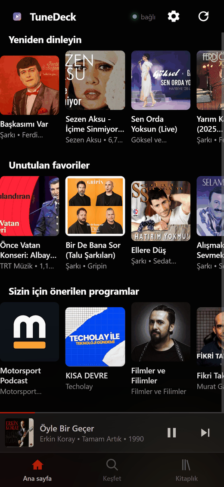

# TuneDeck

YouTube Music doesn't do Spotify Connect. You can't pick up your phone and pause whatever is playing on
the computer, and people have been asking for it in the feedback form for years.

So I wrote one. The PC plays the music, the phone controls it over your home Wi-Fi: play and pause, next
and previous, volume, scrubbing, search, playlists, your library. The Android app adds a media
notification, lock screen controls and a home screen widget, so you can skip a track without unlocking
the phone.

No account linking, no cloud, no API keys. It drives the YouTube Music client you are already signed into,
on your own machine, which is why your likes, history and recommendations stay intact.

Unofficial and not affiliated with Google. It doesn't bypass DRM and doesn't download anything, but it
does automate a Google service, so use your judgement. [Limitations](#limitations) is worth a read before
you install it.

**[Download the Android app](https://github.com/eminsavaskan/tunedeck/releases/latest)** ·
[Install on Windows](#install-on-windows-step-by-step) ·
[Set up your phone](#set-up-your-phone) ·
[How it works](#how-it-works)

<p align="center">
  
</p>

---

## Contents

- [What you need](#what-you-need)
- [How it works](#how-it-works)
- [Install on Windows (step by step)](#install-on-windows-step-by-step)
- [Install on Linux / macOS](#install-on-linux--macos)
- [Set up your phone](#set-up-your-phone)
- [Install the Android app (APK)](#install-the-android-app-apk)
- [Daily use](#daily-use)
- [Troubleshooting](#troubleshooting)
- [FAQ](#faq)
- [Configuration](#configuration)
- [HTTP API](#http-api)
- [Build the APK yourself](#build-the-apk-yourself)
- [Limitations](#limitations)
- [License](#license)

---

## What you need

| | |
|---|---|
| **Computer** | Windows 10/11, Linux or macOS. Plays the music. |
| **Player** | The [YouTube Music desktop app](https://github.com/pear-devs/pear-desktop) (or any Chromium browser) |
| **Python** | 3.10 or newer on the computer |
| **Phone** | Any phone on the **same Wi-Fi** — nothing to install for the basic version |
| **Optional** | Android 8+ phone for the notification / lock-screen / widget app |

You do **not** need: a Google API key, a developer account, root, a server, or an internet connection
beyond what YouTube Music itself needs.

## How it works

```
   ┌─────────────┐    HTTP (port 8777)    ┌──────────────┐
   │   Phone     │ ─────────────────────► │  bridge.py   │
   │ (browser or │ ◄───────────────────── │  on the PC   │
   │  the APK)   │      JSON state        └──────┬───────┘
   └─────────────┘                               │ DevTools Protocol (127.0.0.1:9223)
                                                 ▼
                                    ┌──────────────────────────┐
                                    │ YouTube Music (Electron) │
                                    │ or music.youtube.com     │
                                    └──────────────────────────┘
```

`bridge.py` is a small web server. It connects to the player over the Chromium DevTools Protocol and
clicks the same buttons you would click. Nothing is reimplemented, so your account, likes, history and
recommendations behave exactly as they always do, and switching tracks never interrupts playback.

There is no official API to plug into. The Electron builds that used to expose a "companion server"
(th-ch `youtube-music` v3, `pear-desktop`) dropped it a while back. This fills that gap without patching
the app itself.

---

## Install on Windows (step by step)

> **Shortcut:** run `setup.bat`. It installs the Python packages, adds the debug flag to your YouTube Music
> shortcut, registers the bridge at login and starts it. The manual steps below are what it does.

### 1. Install a player

Install the YouTube Music desktop app from the
[pear-desktop releases page](https://github.com/pear-devs/pear-desktop/releases), or use a Chromium
browser (Chrome / Brave / Edge) instead.

### 2. Install Python

Download it from [python.org](https://www.python.org/downloads/) and **tick "Add python.exe to PATH"**
on the first screen of the installer. Then check it in a terminal:

```bash
python --version
```

### 3. Get this project

```bash
git clone https://github.com/<your-user>/ytm-remote.git
cd ytm-remote
```

No git? Use **Code → Download ZIP** on GitHub, then unzip it anywhere (e.g. `C:\ytm-remote`).

### 4. Install the dependencies

```bash
python -m pip install -r requirements.txt
```

### 5. Give the player a debug port (once)

This is the only fiddly step. The player must be started with `--remote-debugging-port=9223`.

**Desktop app:** right-click its shortcut → **Properties** → in **Target** append the flag, keeping the
quotes intact:

```
"C:\Users\you\AppData\Local\Programs\youtube-music\YouTube Music.exe" --remote-debugging-port=9223
```

Then close the player completely (also from the tray) and open it from that shortcut.

**Browser instead of the app:** skip this step (see [Browser mode](#browser-mode)).

Not sure it worked? `http://127.0.0.1:9223/json/version` should return JSON in the browser. If it does
not, the player was started without the flag.

### 6. Start the bridge

```bash
python bridge.py
```

It prints something like:

```
YT Music Remote  ->  http://192.168.1.50:8777
```

Leave this window open. When Windows asks about the firewall, **allow it on private networks**, otherwise
your phone cannot connect.

### 7. Start the player (any time)

Open YouTube Music as usual. If it is closed, the phone shows an **Open** button instead of pretending to
work.

### Optional: run it in the background

| File | What it does |
|---|---|
| `arka-plan.vbs` | starts the bridge silently, no console window |
| `baslat.vbs` | starts the bridge and opens the QR/setup page |
| `durdur.bat` | stops the bridge |

To start the bridge automatically at login, press `Win+R`, type `shell:startup`, and put a shortcut to
`arka-plan.vbs` in that folder.

---

## Install on Linux / macOS

```bash
git clone https://github.com/<your-user>/ytm-remote.git
cd ytm-remote
python3 -m venv .venv && source .venv/bin/activate
pip install -r requirements.txt
python bridge.py
```

The desktop app is Electron, so the flag works the same way:

```bash
youtube-music --remote-debugging-port=9223
```

For a normal browser, use the [browser mode](#browser-mode) setting instead. Allow port `8777` through
your firewall (on Ubuntu: `sudo ufw allow 8777/tcp`).

---

## Set up your phone

1. Connect the phone to the **same Wi-Fi** as the computer. (Guest networks and "AP isolation" block this.)
2. Open the URL the bridge printed, for example `http://192.168.1.50:8777`.
3. Browser menu → **Add to home screen**. It now opens full-screen like an app.
4. Point the phone at the computer and tap play. Done.

The bridge also serves a QR page: open `http://<computer-ip>:8777/setup` on the computer and scan it with
the phone.

**Multiple phones work.** Every device that opens the URL controls the same player.

## Install the Android app (APK)

The APK is the same interface, wrapped with Android integration (persistent notification, lock-screen
controls, widget, boot start).

1. On the phone open `http://<computer-ip>:8777/app.apk`, or scan the QR code from
   `http://<computer-ip>:8777/setup` on the computer.
2. When Android warns about unknown apps, allow your browser to install apps (one-time setting).
3. Open the installed **YT Music Remote** app.
4. Allow **notifications** when asked (Android 13+). Without it there is no media card.
5. Recommended: **Settings → Battery → Unrestricted** for this app, so the service is not suspended.
6. Samsung/Xiaomi: if the media card does not appear on the lock screen, enable
   *Settings → Notifications → Advanced → Media player* and *Lock screen → Media*. If the official YouTube
   Music app also has no lock-screen player on your phone, the cause is that device setting, not this app.

The APK is signed with a debug key and is not on Google Play. Sideloading is the intended method.

### How updates work

Install once from **Releases** (or from your own bridge). After that the app keeps itself current.

It asks two places, in this order:

| # | Channel | Used when | Source of truth |
|---|---|---|---|
| 1 | **Your bridge** | the phone is on the same Wi-Fi as a running bridge | `GET /api/version` on the PC |
| 2 | **GitHub Releases** | always (fallback, and the normal path for everyone else) | `https://api.github.com/repos/<owner>/<repo>/releases/latest` |

- On start (at most once per 12 h) the app compares the published **version code** with its own.
- If it is newer, **Settings → Update** shows `v2.3 ready`; one tap downloads the APK and hands it to
  Android's package installer.
- Android always shows its own **Install / Cancel** dialog. No app can install silently, by design.
- The GitHub check needs the repo name. It comes from (first match wins): `settings.json → "github"` on
  the bridge, the APK's baked-in `Api.DEFAULT_UPDATE_REPO`, or a preference set by the app. Releases built
  by CI bake in `${{ github.repository }}` automatically, so a downloaded APK already knows where to look
. No bridge or PC needed.
- Unauthenticated GitHub API allows 60 requests/hour per IP; one check per device per 12 h is far below
  that, and failures are silent (the row simply says "up to date").

**Publishing an update (maintainer):**

```bash
# 1. bump the version in android/app/AndroidManifest.xml
#    versionCode="15"  versionName="2.4"      <- versionCode MUST increase
# 2. commit, then tag and push
git tag v2.4 && git push origin v2.4
```

The CI workflow builds the APK on the tag, writes `apk-version.json`, and attaches both to the GitHub
release. Every installed app then sees `versionCode 15 > 14` and offers the update within 12 hours
(or immediately: open Settings → Update and tap it).

You don't need the bridge, the PC or a manual reinstall: one tap, once per release.

---

## Daily use

| I want to… | Do this |
|---|---|
| Listen on the PC, control from the phone | start the bridge, open YouTube Music, open the app |
| Stop everything | close YouTube Music, stop the bridge (`durdur.bat` / Ctrl+C) |
| Keep the PC free of a console window | `arka-plan.vbs` |
| Change the phone's language | gear icon → **Language** (14 languages) |
| Control from a second phone | just open the same URL |

Behaviour you should know:

- If the player is **closed on the PC, it stays closed**. The phone shows "YouTube Music is closed on the
  computer" with an **Open** button. Nothing starts behind your back.
- If the phone loses Wi-Fi, the Android card disappears after ~9 seconds instead of hanging around.
- Volume set from the phone is re-applied after a track change (YouTube Music resets its own volume).

---

## First run

The app carries its own setup guide. If it cannot reach the computer, it shows a native screen instead of
a browser error: the bridge address, a retry button, and a menu (⋮) with **How to set up**, the address
field and the version.

The same guide is on `http://<computer-ip>:8777/setup` in a browser.

## Troubleshooting

| Symptom | Cause | Fix |
|---|---|---|
| Phone cannot open the page | different network, AP isolation, firewall | same Wi-Fi? allow Python on private networks; get the PC's IP with `ipconfig` |
| Page loads, but "computer unreachable" | bridge stopped | start `bridge.py` again |
| "YouTube Music is closed on the computer" | player is not running | open the player, or tap **Open** |
| "App is open but remote control is off" | player started **without** `--remote-debugging-port=9223` | quit it fully, start it from the patched shortcut |
| `http://127.0.0.1:9223/json/version` shows nothing | same as above | fix the shortcut |
| Search returns unrelated songs | YouTube Music's own search ranking | type more of the title; results are re-ranked against your query |
| Volume jumps back | a track change reset it | it re-applies automatically; if not, set it again |
| No notification / no lock-screen card | notification permission, battery optimisation, or OEM media settings | see [APK step 4–6](#install-the-android-app-apk) |
| Widget does nothing | service stopped | open the app once; the widget needs the background service |
| `Port 8777 already in use` | bridge already running | use the running one, or `YTM_PORT=8778 python bridge.py` |
| Titles/artwork empty while music plays | YouTube Music was reloaded | wait a few seconds, state re-syncs automatically |

Still stuck? Open the setup page (`/setup`) or check `bridge.log`. The bridge logs every failure.

---

## FAQ

**Does it work with the real music.youtube.com in Firefox?**
No. Firefox speaks WebDriver BiDi, not the Chrome DevTools Protocol. Use Chrome, Brave, Edge or the
desktop app.

**Can the phone play the music instead of the PC?**
No. YouTube Music has no "cast to another device" API, so the audio always comes from the machine that
plays it. The phone is the remote.

**Two people, two accounts?**
One player = one account. Run two computers with two bridges (different ports) if you need that.

**Is my Google password involved?**
Never. The bridge talks to the already-logged-in player on your own computer. It has no Google credentials
at all.

**Is it safe to expose?**
The bridge listens on your LAN only and has no cloud component. Anyone on your Wi-Fi can control the
player. That is the point. If you don't want that, set a `token` (see [Configuration](#configuration)).

**Will a YouTube Music update break it?**
Possibly. Everything is driven through the page's DOM; a redesign can break selectors. Fixes are usually
small. That is the cost of an app with no public API.

---

## Configuration

`settings.json` (next to `bridge.py`, copied from `settings.example.json` if missing):

```json
{
  "app": "",          // path to the player executable (empty = default install location)
  "browser": "",      // path to brave.exe / chrome.exe → run music.youtube.com instead of the app
  "token": "",        // optional shared secret: if set, /api calls need ?t=<token>
  "autostart": false  // start the player when the bridge starts
}
```

Environment variables override everything:

| Variable | Default | Meaning |
|---|---|---|
| `YTM_PORT` | `8777` | HTTP port of the bridge |
| `YTM_DEBUG_PORT` | `9223` | DevTools port of the player |
| `YTM_APP` | auto | player executable |
| `YTM_BROWSER` | – | browser executable (turns on browser mode) |
| `YTM_BROWSER_PROFILE` | `./browser-profile` | profile folder used in browser mode |

### Browser mode

Put your Chromium path in `settings.json` → `"browser"` (or `YTM_BROWSER`). The bridge then opens
`music.youtube.com` in a dedicated profile with debugging enabled, so your normal browser profile stays
untouched. Log in once inside that window and it is remembered.

```bash
YTM_BROWSER="C:/Program Files/BraveSoftware/Brave-Browser/Application/brave.exe" python bridge.py
```

---

## HTTP API

Everything the apps use is a plain HTTP endpoint, good enough to script your own remote (Stream Deck,
Home Assistant, a macro keyboard…).

| Method & path | Body | Returns |
|---|---|---|
| `GET /api/state` | – | `title, byline, art, playing, position, duration, volume, volume_pct, muted, logged_in, online` |
| `GET /api/home` | – | `shelves: [{title, items:[{kind,id,title,sub,img}]}]` |
| `GET /api/library` | – | `items[]` — playlists and albums |
| `GET /api/info` | – | `url, device, app_up` |
| `GET /api/version` | – | `version, code, size, sha256, built, apk` — used by the auto-updater |
| `POST /api/list` | `{"href":"playlist?list=…"}` | `title, cover, items[]` |
| `POST /api/search` | `{"q":"tarkan"}` | `items[]`, re-ranked against the query |
| `POST /api/play` | `{"id":"<videoId>"}` | plays that track |
| `POST /api/toggle` | `{}` | play / pause |
| `POST /api/next`, `/api/prev` | `{}` | skip |
| `POST /api/volume` | `{"pct":0-100}` | set volume |
| `POST /api/mute` | `{}` | toggle mute |
| `POST /api/seek` | `{"t":seconds}` | seek |
| `POST /api/launch` | `{"restart":false}` | start the player on the PC |

`kind` is `song` or `list`; ids are YouTube video ids. Example:

```bash
curl -s http://192.168.1.50:8777/api/state
curl -s -X POST http://192.168.1.50:8777/api/search -H 'content-type: application/json' -d '{"q":"Sezen Aksu"}'
```

---

## Build the APK yourself

No Gradle, no Android Studio, no AndroidX. Just the SDK tools.

```bash
cd android
bash build.sh
```

Requirements: JDK 17, Android **build-tools** (aapt2, d8, zipalign, apksigner) and an
`android.jar` (platform 34). The script finds them via `ANDROID_SDK_ROOT` / `ANDROID_HOME` / `android/sdk`
and prints which ones it picked. Output: `ytm-remote.apk` in the project root.

If your SDK is elsewhere:

```bash
ANDROID_SDK_ROOT=/opt/android-sdk JAVA_HOME=/opt/jdk-17 bash android/build.sh
```

`.github/workflows/apk.yml` builds the APK on GitHub for every tag (`v*`) and uploads it as an artifact.

---

## Tests

Two self-contained suites, no test framework needed:

```bash
python bridge.py                 # in one terminal
python tests/api_test.py         # 120+ checks: contract, edge cases, concurrency
node tests/i18n_audit.js i18n.js # every language complete, placeholders, RTL list
```

`api_test.py` exercises every endpoint with valid, empty, malformed, wrong-typed and hostile input
(invalid JSON, 500-char queries, XSS payloads, path traversal, 16 parallel requests) and checks that
nothing returns a 500 or hangs. Both suites exit non-zero on failure, so they can run in CI.

## Limitations

- **DOM driven.** Playback, search and navigation use YouTube Music's own elements (`#progress-bar`,
  `.title`, `ytmusic-*`). A Google redesign can break it. Fixes are usually a few selectors.
- **One player per bridge.** The phone remote controls the machine running `bridge.py`.
- **Phone is the remote, not the player.** Audio always comes from the computer.
- **Unofficial.** No DRM circumvention, no downloading, no API keys; it automates the client you are
  already logged into. Automating a Google service can violate its terms. Your call.
- **Debug-signed APK.** Fine for sideloading, not for a store.
- **Some OEMs** (Samsung, Xiaomi, Huawei) hide media cards by default. The app cannot override a system
  setting; the official YouTube Music app would be hidden the same way.

## Contributing

Issues and PRs welcome. When reporting a broken control, include your YouTube Music version, the
`/api/state` output and what the element looks like now. That usually makes the fix a one-liner.

## Renaming / rebranding

The name lives in four places (the package id `com.emin.ytmremote` must **not** change, because updates are tied
to it):

| Where | What |
|---|---|
| `android/app/res/values/strings.xml` | `app_name` → launcher + task switcher label |
| `ui.html` | top bar brand text and the inline logo mark |
| `bridge.py` | `manifest.webmanifest` name/short_name, `/setup` heading |
| `tools/make-icon.py` | icon artwork (run it to regenerate every PNG) |

## License

MIT, see [LICENSE](LICENSE). "YouTube", "YouTube Music" and the play logo are trademarks of Google LLC.
This project is not affiliated with, endorsed by, or supported by Google.
